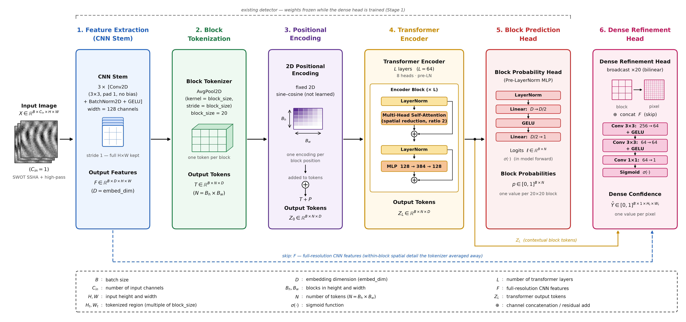
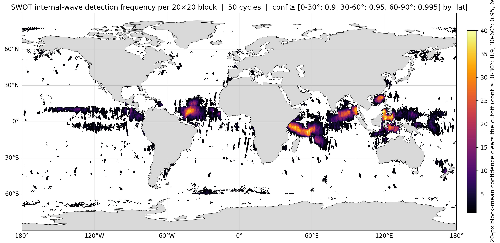
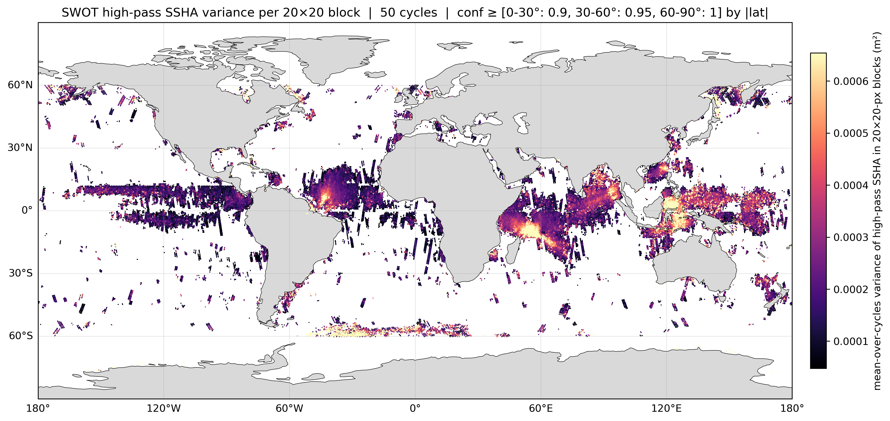

# Deep Learning for Internal Solitary Wave Detection in SWOT

Cross-framework comparison of deep detectors for **internal solitary waves
(ISWs)** in SWOT L3 sea-surface-height data, plus a weakly-supervised head that
sharpens block-level detections to pixel resolution. Four model families — YOLO11,
Faster R-CNN, RT-DETR, and a purpose-built CNN-Transformer block classifier — are
trained on the same labeled Bay of Bengal set, evaluated against one shared
block-level yardstick, and probed for out-of-distribution generalization on three
held-out ocean regions.

## The problem

Internal solitary waves are waves that travel *inside* the ocean, along the
boundary between warm surface water and cold deep water rather than on top. They
are usually set off when a tide drags water across an undersea ridge. Each one
pulls the sea surface into a train of long, evenly spaced ripples, and the SWOT
satellite is now precise enough to see that pattern from space.

The input is **SWOT L3 SSHA** (AVISO `ssha_unfiltered`, ~2 km pixel spacing,
21-day repeat orbit so each pass number re-images the same ground track every
cycle). From it the project derives several high-pass / gradient representations —
`gaussian_filter_highpass`, `rolling_mean_highpass`, `stepped_convolution_highpass`,
`fft_highpass`, `gradient_magnitude` — and a 3-channel "scientific RGB" composite
(R = quality-masked SSHA, G = high-pass SSHA, B = gradient magnitude). The labeled
training and evaluation set is the **Bay of Bengal (BoB)** dataset: 50 SWOT cycles
across 43 orbit passes, clipped to 3.0–15.5°N at full cross-track width, each image
a 700×60-pixel grid (105 blocks of 20×20 px). Splits are grouped by pass so no
ground track leaks across them: 1149 train / 225 val / 254 test images, with the
training set augmented 3× offline. Three further labeled regions — **Amazon Mouth**,
**Mascarene Ridge**, and **South China Sea** — are held out entirely for
out-of-distribution (OOD) evaluation.

## Two task framings, one yardstick

| framing | models | operates on |
|---|---|---|
| **Bounding-box detection** of `IW` packets (single class) | YOLO11, Faster R-CNN, RT-DETR | rendered image chips |
| **Per-20×20-px-block binary classification** ("does this ~40×40 km block contain an ISW?") | CNN-Transformer `BlocksTokenModel` | the NetCDF directly |

The box detectors' predictions are rasterized and averaged onto the same 20×20
block grid, so all four families are scored by a single script,
`eval/evaluate_block_metrics.py`, on the identical held-out BoB test split:
precision / recall / F1 at a validation-selected operating point, plus
threshold-free AP over the block-level PR curve.

## CNN-Transformer architecture

The block classifier runs six stages: a stride-1 **CNN stem** (3× Conv3×3 →
BatchNorm → GELU, width 128) → a **block tokenizer** (`AvgPool2d(20, 20)`, one
token per block) → fixed 2-D **sine-cosine positional encoding** → a 64-layer
**pre-LayerNorm transformer encoder** with spatial-reduction attention → a
**per-block sigmoid head** producing one confidence per 20×20 block. An optional
**dense refinement head** (stage 6) broadcasts each block token over its own 20×20
footprint, concatenates a skip connection carrying full-resolution stem features,
and passes it through three convolutions to a per-pixel sigmoid map. The dense
head is trained with stages 1–5 frozen, distilling the frozen block detector as a
teacher plus an edge-guidance term — **no pixel labels**.

## The four model families

| family | detector type | backbone / params | framing | notable code detail |
|---|---|---|---|---|
| **YOLO11** | one-stage anchor-free | YOLO11n ~2.6M (planned YOLO11s ~9.4M) | box | trained through Ultralytics; all online augmentation off (data is pre-augmented) |
| **Faster R-CNN** | two-stage R-CNN | ResNet-50-FPN ~41.4M | box | custom tall anchors (ratios 1/2/4/8); **CPU-only — MPS backward pass is silently corrupt**, guarded by a pre-flight gradient check |
| **RT-DETR** | query-based transformer | r50vd ~42.7M | box | HuggingFace `transformers`, no NMS; monkeypatches an MPS float64 crash in the sinusoidal position embedding |
| **CNN-Transformer** | block classifier (+ dense head) | ~10.9M + ~0.18M | block / pixel | trains directly on raw NetCDF; 10 channel-selection variants |

Every family is trained at seeds `{123, 456, 789}` and its three seeds aggregated
into mean ± sample standard deviation.

## Global-scale results

Running a trained detector over ~50 SWOT cycles of global L3 data and pooling by
20×20-px block yields two maps (both generated by scripts under
`cnn-transformer/src/inference/`):

*Detection recurrence: the number of SWOT repeat cycles (of ~50) in which each
20×20-px block's mean confidence cleared a per-latitude-band threshold. The known
internal-wave hotspots light up — Andaman Sea / Bay of Bengal, Sulu and Sulawesi
seas, South China Sea, the Amazon shelf, the Mascarene Ridge, and the tropical
Pacific.* Generator: `cnn-transformer/src/inference/plot_detection_frequency.py`.

*Wave strength: the mean-over-cycles variance (m²) of high-pass SSHA inside
detection-gated 20×20 blocks — a proxy for the sea-surface-height amplitude of the
detected waves, brightest over the Andaman Sea, the Sulu/Sulawesi seas, the Amazon
shelf, and the ACC band near 60°S.* Generator:
`cnn-transformer/src/inference/plot_highpass_variance.py`.

## Repository layout

| path | contents |
|---|---|
| `cnn-transformer/` | `BlocksTokenModel` block classifier + the dense refinement head, and the global-scale inference / map-plotting scripts. [README](cnn-transformer/README.md) |
| `faster-rcnn/` | torchvision Faster R-CNN (ResNet-50-FPN) box detector. [README](faster-rcnn/README.md) |
| `rt-detr/` | RT-DETR box detector built on HuggingFace `transformers`. [README](rt-detr/README.md) |
| `yolo11/` | YOLO11 box detector (Ultralytics) + its box-level `model.val()` path. [README](yolo11/README.md) |
| `eval/` | `evaluate_block_metrics.py` — the shared block-level scoring script all four families feed. |
| `ood_comparison/` | combines the OOD block metrics across families and differences them against the BoB baseline. |
| `figures/` | paper figures and their generators (`cnn-transformer-diagram.py`; the two global maps above). |
| `training_dense_head/` | `qualitative_comparison.ipynb` — dense map vs. interpolation-baseline figure. |

`data/`, `runs*/`, and `results*/` are git-ignored (datasets, weights, and heavy
inference NetCDFs); `eval_results*/` and `yolo_val_results*/` — the scored CSVs —
are committed.

## Shared evaluation

`eval/evaluate_block_metrics.py` is the single scoring script every family
invokes. From each slim inference NetCDF it reads `block_mask` (ground truth),
`internal_wave_bbox_confidence` (the model's pixel-level confidence field), and
`gaussian_filter_highpass` (used to find blocks with real swath data). It crops to
whole 20×20 blocks and reduces each block to a binary majority-vote ground-truth
label (positive if more than 25% of finite pixels are positive) and a
mean-confidence prediction. It then selects **one** confidence threshold at the
maximum smoothed-F1 point of an Ultralytics-style PR sweep on the **pooled
validation set** (restricted to `[0.05, 0.95]` to avoid the degenerate
predict-everything threshold) and applies it unchanged to the test set; AP
integrates the whole test curve and needs no threshold. Outputs are
`block_metrics_overall.csv` (one pooled row) and `block_metrics_per_file.csv`.
Each family's `aggregate_*.py` then rolls the three seeds per variant into
mean ± std (`ddof=1`) → `summary_by_variant.csv`.

## Out-of-distribution study

`ood_comparison/` evaluates frozen BoB-trained checkpoints — inference only — on
the three held-out regions, scored at each model's **BoB-validation** operating
point (OOD data never touches training, validation, or threshold selection).
`build_ood_comparison.py` joins each OOD result to its BoB-test baseline and
computes, per metric, `delta = ood_mean − in-distribution_mean` (negative ⇒ OOD
worse) into `ood_vs_ogtest_diff.csv`; `plot_ood_deltas.py` renders four bar charts
into `ood_comparison/figures/`. Only four configurations were run OOD:
CNN-Transformer `gfh` / `shg` and YOLO11n `gauss` / `frgb`.

## Where to look next

- **CNN-Transformer** block classifier and dense head → [`cnn-transformer/README.md`](cnn-transformer/README.md)
- **Faster R-CNN** baseline → [`faster-rcnn/README.md`](faster-rcnn/README.md)
- **RT-DETR** baseline → [`rt-detr/README.md`](rt-detr/README.md)
- **YOLO11** baseline → [`yolo11/README.md`](yolo11/README.md)
# SWOT-JPL-WORK
